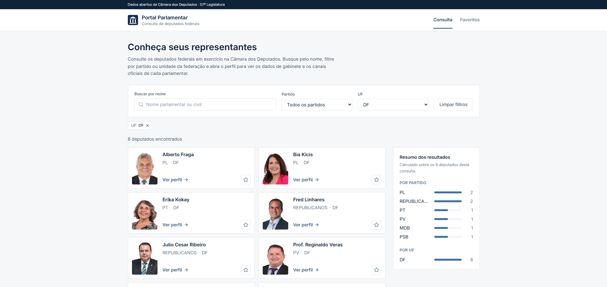
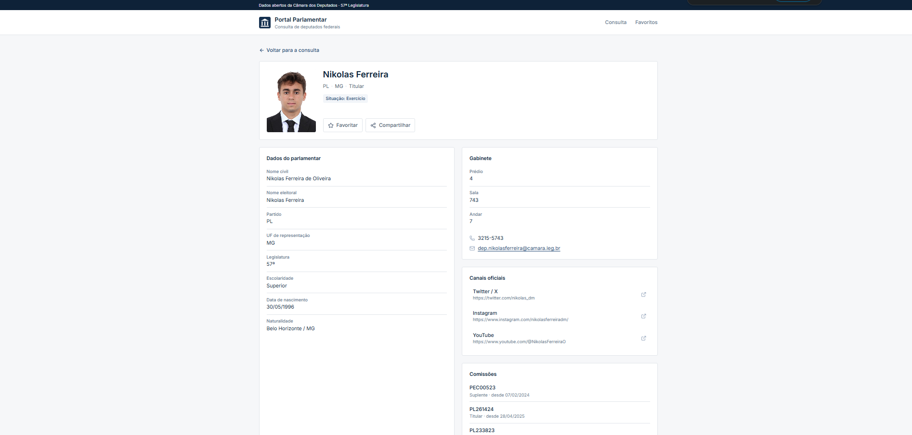

# Portal Parlamentar

Projeto desenvolvido em React para consultar informações de deputados federais utilizando a
API de Dados Abertos da Câmara dos Deputados. A aplicação permite pesquisar deputados por
nome, filtrar por partido e por UF, abrir o perfil individual de cada parlamentar e salvar
uma lista de favoritos no navegador.

Atividade da disciplina de Desenvolvimento de Interfaces.

## Tecnologias

- React 19 com Vite
- TypeScript
- Tailwind CSS 4
- React Router DOM
- Lucide React (ícones)
- Fetch API

## Funcionalidades

- Busca de deputados por nome, com espera de 400 ms após a digitação.
- Filtros por partido e por UF, combináveis com a busca e removíveis individualmente.
- Listagem em cards com foto oficial, nome parlamentar, sigla do partido e UF.
- Botão "Carregar mais", que traz 24 registros por vez.
- Resumo com a distribuição dos resultados por partido e por UF.
- Página de perfil com dados pessoais, gabinete (prédio, sala, andar, telefone e e-mail) e
  links para as redes sociais informadas pela Câmara.
- Comissões em que o parlamentar atua no momento, com o cargo e a data de início.
- As dez proposições mais recentes de autoria dele, com link para a ficha de tramitação no
  site da Câmara.
- Favoritos salvos no `localStorage`, com página própria.
- Botão de compartilhamento usando a Web Share API, com cópia do link como alternativa.
- Estados de carregamento, lista vazia e erro de requisição.

Quando a API não informa algum dado, o campo aparece como "Não informado". Nenhuma
informação é inventada.

## Como executar

Requer Node.js 20.19 ou superior (o Vite 8 não roda em versões anteriores).

```bash
npm install
npm run dev
```

A aplicação abre em `http://localhost:5173`.

Outros comandos:

```bash
npm run build    # verificação de tipos e build de produção
npm run preview  # serve o build gerado
npm run lint     # análise estática
```

## API utilizada

Base: `https://dadosabertos.camara.leg.br/api/v2`

| Endpoint | Uso |
| --- | --- |
| `GET /deputados` | Listagem, com os parâmetros `nome`, `siglaPartido`, `siglaUf`, `pagina` e `itens` |
| `GET /deputados/{id}` | Dados completos de um deputado, gabinete e redes sociais |
| `GET /deputados/{id}/orgaos` | Comissões e demais órgãos de que o deputado participa |
| `GET /proposicoes?idDeputadoAutor={id}` | Proposições apresentadas pelo deputado |
| `GET /partidos` | Opções do filtro de partido |
| `GET /referencias/uf` | Opções do filtro de UF |

O endpoint `/uf`, citado em alguns materiais, não existe na versão 2 da API. A lista de
unidades da federação está em `/referencias/uf`.

A API não devolve o total de registros de uma consulta. Ela indica, no campo `links`, se
existe uma próxima página — é esse link que o projeto usa para decidir se mostra o botão
"Carregar mais" e para avisar que o resumo considera apenas os resultados já carregados.

## Estrutura do projeto

```text
src/
├── components/
│   ├── Cabecalho.tsx          Topo e navegação
│   ├── DeputadoCard.tsx       Card da listagem
│   ├── Filtros.tsx            Busca, selects e filtros ativos
│   └── ResumoResultados.tsx   Distribuição por partido e por UF
├── pages/
│   ├── Home.tsx               Consulta e listagem
│   ├── DeputyDetails.tsx      Perfil individual
│   ├── Favorites.tsx          Lista salva no navegador
│   └── NotFound.tsx           Rota inexistente
├── services/
│   └── camaraApi.ts           Funções que acessam a API
├── favoritos.ts               Leitura e gravação no localStorage
├── types.ts                   Tipagem das respostas da API
├── App.tsx                    Rotas e layout
├── main.tsx
└── index.css
```

## Como o projeto funciona

**Organização em componentes.** `App.tsx` define as rotas e o layout fixo (cabeçalho,
conteúdo e rodapé). Cada rota renderiza uma página, e as páginas usam componentes menores
que recebem dados por props. `DeputadoCard`, por exemplo, não busca nada: ele recebe o
deputado, se é favorito e a função a chamar no clique da estrela.

**Consulta à API.** Todas as chamadas ficam em `services/camaraApi.ts`. A função
`buscarNaApi` monta a URL com `URL` e `searchParams`, ignora parâmetros vazios, faz o
`fetch` e lança um erro se a resposta não for bem-sucedida. As demais funções do arquivo só
dizem qual caminho e quais parâmetros usar.

**Pesquisa por nome.** O campo é controlado pelo estado `busca`, que muda a cada tecla. Um
`useEffect` com `setTimeout` de 400 ms copia esse valor para `buscaAplicada`; se o usuário
digitar de novo antes disso, o `clearTimeout` do retorno do efeito cancela o agendamento
anterior. Só `buscaAplicada` dispara a consulta, então uma palavra inteira gera uma
requisição em vez de uma por letra.

**Filtros.** `buscaAplicada`, `partido` e `uf` são enviados juntos como parâmetros da API,
que já devolve a lista filtrada. Ao trocar um filtro, a página volta para 1. O efeito que
consulta a API cria um `AbortController` e o cancela no retorno, de modo que a resposta de
uma consulta antiga não sobrescreva uma mais recente.

**Paginação.** O estado `pagina` começa em 1. Quando é 1, a lista é substituída; quando é
maior, os novos registros são adicionados aos existentes. O botão "Carregar mais" aparece
enquanto a API indicar que há próxima página.

**Navegação para o perfil.** O card tem um `Link` para `/deputados/:id`. Na página de
detalhes, `useParams` lê o id da URL e um `useEffect` busca os dados em
`GET /deputados/{id}`.

**Dados do gabinete.** Vêm dentro de `ultimoStatus.gabinete` na resposta da API. O
componente `Campo` recebe o rótulo e o valor e mostra "Não informado" quando o valor é nulo.
Se a API não retornar o objeto de gabinete, a seção inteira exibe um aviso.

**Comissões e proposições.** São buscadas em um segundo `useEffect`, separado do primeiro,
com `Promise.all`. Ficam isoladas de propósito: se um desses endpoints falhar, as seções
mostram que não há dados e o restante do perfil continua funcionando. Das comissões, são
listadas apenas as que não têm `dataFim`, ou seja, as participações em andamento.

## Publicação na Vercel

O arquivo `vercel.json` redireciona todas as rotas para `index.html`, o que é necessário
para que `/deputados/:id` e `/favoritos` funcionem ao serem acessados diretamente.

O projeto está publicado na Vercel, com o Root Directory apontando para esta pasta e o
preset Vite. Não há variáveis de ambiente, já que a API da Câmara é pública.

**URL pública:** https://dw2026-sistemadeputados.vercel.app

## Capturas de tela

**Listagem e filtros**



**Perfil do deputado**

